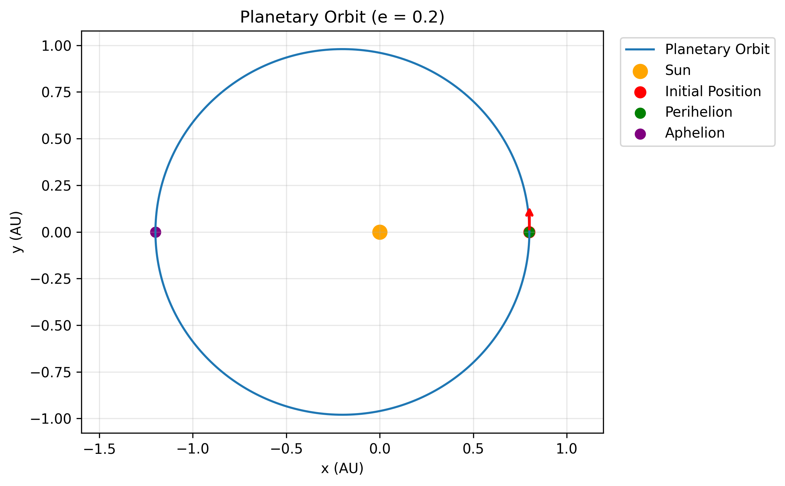

# Numerical Study of Planetary Motion and Verification of Kepler's Second Law

## Objective

To investigate Kepler’s second law of planetary motion using numerical simulation and examine how the choice of numerical integration method and timestep affects the accuracy of the simulated orbit.

Kepler’s second law states that the line joining a planet and the Sun sweeps out equal areas in equal intervals of time. This is equivalent to conservation of angular momentum for motion under a central force.

## Physical Model

The planet is modelled as a body moving under the gravitational attraction of the Sun. The Sun is assumed to remain fixed at the origin, and the planet’s motion is treated as a two dimensional problem.



Using Newton’s law of gravitation, the equations of motion are

$$
\frac{d^2x}{dt^2} = -\frac{\mu x}{r^3}
$$

$$
\frac{d^2y}{dt^2} = -\frac{\mu y}{r^3}
$$

where

$$
r = \sqrt{x^2+y^2}, \qquad \mu = GM
$$

Here, $r$ is the distance between the planet and the Sun, and $\mu$ is the gravitational parameter.


The simulation uses astronomical units (AU) for distance and years for time, with $\(\mu=4\pi^2\)$ for the idealised solar system.

The model assumes:
- The Sun is stationary and its gravitational influence dominates.
- The planet’s mass is negligible compared with the Sun’s mass.
- Other planets, perturbations and relativistic effects are neglected.
- The orbit is determined by the initial position and velocity.
## Numerical Methods

The primary numerical integration method used in this project is the **Explicit Euler Method**. Its accuracy and behaviour are investigated through orbital simulations and timestep analysis. A brief comparison with two other numerical integration methods, RK4 and Velocity Verlet, is also included.

### Explicit Euler Method

Euler's method is used to numerically solve the equations of motion by updating position and velocity using their current values and the calculated acceleration at each timestep. Its simplicity makes it suitable for studying the numerical behaviour of planetary motion, although errors can accumulate over time.

### Comparison with Other Integration Methods

For comparison, two additional numerical methods are briefly implemented:

- **Runge–Kutta (RK4):** Evaluates the system at multiple intermediate points within each timestep to obtain a more accurate numerical update.
- **Velocity Verlet:** Updates position and velocity using acceleration at the current and subsequent positions. It is commonly used in mechanics simulations because of its favourable long term energy behaviour for suitable conservative systems.

These methods are compared with Euler integration under the same physical model and initial conditions to examine differences in numerical accuracy.

## Verification of Kepler’s Second Law

The swept area over a short timestep is approximated using the triangle formed by the Sun and the planet’s positions at successive timesteps:

$$
\Delta A \approx \frac{1}{2}
\left|x_i y_{i+1}-y_i x_{i+1}\right|.
$$

The corresponding approximate areal velocity is

$$
K_i=\frac{\Delta A}{\Delta t}.
$$

If Kepler’s second law is satisfied, the areal velocity should remain approximately constant. The simulated values are examined over time and compared with the theoretical areal velocity for an elliptical orbit:

$$
K_{\mathrm{theory}}=
\frac{1}{2}\sqrt{\mu a(1-e^2)},
$$

where \(a\) is the semi-major axis and \(e\) is the orbital eccentricity.

## Validation Against JPL Reference Data

The Earth orbit simulation is also compared with reference state data from NASA/JPL Horizons.

The initial position and velocity are taken from the reference state at the chosen epoch. The simulated trajectory is then compared with the reference trajectory over the selected validation interval.

The position error is calculated as

$$
\text{Position Error \%}=
\frac{\left|\mathbf r_{\mathrm{sim}}-\mathbf r_{\mathrm{ref}}\right|}
{\left|\mathbf r_{\mathrm{ref}}\right|}\times100.
$$

Here, $\(\mathbf r_{\mathrm{sim}}\)$ and $\(\mathbf r_{\mathrm{ref}}\)$ are the simulated and reference position vectors, respectively.

**JPL Reference Data and Validation Setup**

- **Reference epoch:** 1 January 2026
- **Validation period:** 360 days
- **Reference source:** NASA/JPL Horizons
- **Coordinate system:** Heliocentric Cartesian coordinates
- **Integration method:** Explicit Euler
- **Timestep:** $10^{-6}$ year

The simulated trajectory was compared with JPL Horizons reference data over the validation period. The deviation was evaluated using position error and radial error, calculated from the simulated and reference position vectors.

## Results and Analysis

### Verification of Kepler's Second Law

The numerical areal velocity was compared with its theoretical value to examine the conservation of areal velocity throughout the orbit.

| Parameter | Result |
|---|---:|
| Selected timestep | $1 \times 10^{-6}$ years |
| Mean numerical areal velocity | 3.07818418 AU²/year |
| Theoretical areal velocity | 3.07811959 AU²/year |
| Maximum variation in areal velocity | 0.002098% |
| Error from theoretical value | 0.002098% |

The numerical result closely agrees with the theoretical value, supporting the verification of Kepler's Second Law.

### Timestep Analysis
#### Kepler Verification

The effect of timestep size on numerical accuracy was investigated by comparing the mean areal velocity obtained at different timesteps.

| Timestep (years) | Mean Areal Velocity (AU²/year) | Change from Previous Timestep (%) |
|---:|---:|---:|
| $1.0\times10^{-2}$ | 3.55708214 | — |
| $5.0\times10^{-3}$ | 3.34039875 | 6.091605 |
| $1.0\times10^{-3}$ | 3.13880460 | 6.035032 |
| $5.0\times10^{-4}$ | 3.10936213 | 0.938015 |
| $1.0\times10^{-4}$ | 3.08453423 | 0.798489 |
| $5.0\times10^{-5}$ | 3.08133807 | 0.103619 |
| $1.0\times10^{-5}$ | 3.07876510 | 0.083502 |
| $5.0\times10^{-6}$ | 3.07844246 | 0.010480 |
| $1.0\times10^{-6}$ | 3.07818418 | 0.008390 |

The results show that reducing the timestep improves numerical accuracy and brings the calculated areal velocity closer to its theoretical value.

#### JPL Real Data

A separate timestep convergence analysis was performed using Earth's initial position and velocity obtained from NASA/JPL Horizons data. The final simulated position was compared across different timestep sizes over a 360-day interval.

| Timestep (years) | Change in Final Position (%) |
|---:|---:|
| 1.0 × 10⁻² | 0.000000 |
| 5.0 × 10⁻³ | 60.291444 |
| 1.0 × 10⁻³ | 84.412378 |
| 5.0 × 10⁻⁴ | 16.591322 |
| 1.0 × 10⁻⁴ | 14.742360 |
| 5.0 × 10⁻⁵ | 1.973107 |
| 1.0 × 10⁻⁵ | 1.554684 |
| 5.0 × 10⁻⁶ | 0.193858 |
| 1.0 × 10⁻⁶ | 0.158421 |

The results show that the final simulated position becomes less sensitive to changes in timestep as the timestep is reduced.

### Comparison of Numerical Integration Methods

Euler, Runge–Kutta (RK4), and Velocity Verlet methods were compared using position and energy errors.

| Method | Maximum Position Error (%) | Final Position Error (%) | Maximum Energy Error (%) |
|:---|---:|---:|---:|
| Euler | $6.475959\times10^{-2}$ | $6.475959\times10^{-2}$ | $8.916568\times10^{-3}$ |
| RK4 | $1.319612\times10^{-11}$ | $8.321857\times10^{-12}$ | $5.777441\times10^{-12}$ |
| Velocity Verlet | $2.199767\times10^{-8}$ | $2.184155\times10^{-8}$ | $1.050000\times10^{-9}$ |

RK4 and Velocity Verlet show substantially lower position and energy errors than the Explicit Euler method under the tested conditions. RK4 produces the smallest errors among the three methods, while Velocity Verlet also demonstrates high numerical accuracy.

### Validation Using NASA/JPL Horizons Data

The simulated Earth trajectory was compared with reference ephemeris data obtained from NASA/JPL Horizons.

| Parameter | Result |
|---|---:|
| Integration method | Euler |
| Timestep | $10^{-6}$ years |
| Validation period | 360 days |
| Final position error | 11.650035% |
| Final radial error | 0.007723% |

The difference between the final position error and radial error indicates that the simulation can reproduce the orbital radius more accurately than the full position vector over the validation period. This highlights the limitations of explicit Euler integration over longer simulations.

## Limitations

The simulation uses a simplified two-body model and therefore does not account for perturbations from other planets or other effects included in high precision orbital calculations. 

Numerical accuracy depends on the timestep and integration method. A smaller timestep can reduce discretisation error, but it increases computational cost and does not eliminate all modelling or numerical errors.

The swept area calculation is also an approximation over a finite timestep. Consequently, the measured areal velocity can vary slightly even when the underlying continuous physical model conserves angular momentum.

## Conclusion

This project uses Explicit Euler method to investigate Kepler’s second law and examine the accuracy of simulated planetary motion. By comparing integration methods, varying the timestep and validating the simulated Earth orbit against JPL reference data, the project explores the relationship between physical modelling, numerical methods and computational accuracy.

## Tools

- Python
- NumPy
- Matplotlib
- NASA/JPL Horizons reference data

## How to Run

Open `Kepler's Second Law.ipynb` in Google Colab or Jupyter Notebook.

Install the required libraries using:

```bash
pip install -r requirements.txt
```

## Reproducibility

The simulation notebook and supporting figures are provided in this repository. The initial conditions, timestep, integration method and validation interval should be documented so that the results can be reproduced and independently checked.
